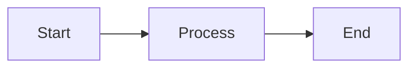

上面的是YAML Front Matter形式的Markdown元数据(Markdown Metadata), Obsidian与Typora均可用, 但不是Markdown原生语法

# Markdown 语法速查表

这是 Markdown 语法的快速参考备忘单，涵盖了最常用的语法元素。

## 标题语法

### ATX 风格标题

# 一级标题

## 二级标题

### 三级标题

#### 四级标题

##### 五级标题

###### 六级标题

### Setext 风格标题

# 一级标题

## 二级标题

## 文本格式

**粗体文本**  
**粗体文本**

*斜体文本*  
*斜体文本*

***粗斜体文本***  
***粗斜体文本***

~~删除线文本~~

`行内代码`

==高亮文本==

## 段落和换行

这是第一个段落。

这是第二个段落。

这是一行文本。  
这是新的一行（行尾两个空格）。

## 列表

### 无序列表

- 项目 1

- 项目 2

  - 子项目 2.1
  - 子项目 2.2

- 使用星号

- 使用加号

### 有序列表

1. 第一项
2. 第二项
   1. 子项目 2.1
   2. 子项目 2.2
3. 第三项

### 任务列表

- [x] 已完成任务
- [ ] 未完成任务
- [ ] 另一个任务

## 链接

[链接文本](https://www.markdownlang.com)  
[带标题的链接](https://www.markdownlang.com "链接标题")

[[main]] ←这个wiki链接不是原生markdown格式

[参考式链接](https://www.markdownlang.com "链接标题")

[https://www.markdownlang.com](https://www.markdownlang.com)  
[email@example.com](mailto:email@example.com)

直接识别 https://www.markdownguide.org/

阻止直接识别 `https://www.markdownguide.org/`

## 图片

有替代文本

有图片标题(光标放在图片上方显示文本)

图片链接(图片语法嵌套入链接语法)[](https://www.markdownlang.com)

## 引用

> 这是一个引用
>
> 引用的第二段

> 一级引用
>
> > 二级引用
> >
> > > 三级引用

## 代码

### 行内代码

使用 `code` 标记行内代码

### 代码块

```
普通代码块
```

```javascript
// 带语法高亮的代码块
function hello() {
    console.log("Hello, World!");
}
```

### 缩进代码块

```
这是缩进代码块
使用 4 个空格或 1 个制表符
```

## 表格

| 左对齐 | 居中对齐 | 右对齐 |
| --- | :---: | ---: |
| 内容1 | 内容2 | 内容3 |
| 内容4 | 内容5 | 内容6 |

## 分隔线

---

---

---

---

## 换行

方式1：行尾添加两个空格  
然后换行

方式2：使用 HTML 标签

换行

方式3：空行分隔

新段落

## 转义字符

\*不是斜体\*   
\#不是标题  
\[不是链接\]

可转义的字符：

```
\   反斜杠
`   反引号
*   星号
_   下划线
{}  大括号
[]  方括号
()  圆括号
#   井号
+   加号
-   减号
.   句点
!   感叹号
```

## 脚注

这里有一个脚注引用[^1](%E8%BF%99%E6%98%AF%E8%84%9A%E6%B3%A8%E7%9A%84%E5%86%85%E5%AE%B9%E3%80%82)。

## HTML 标签

Markdown 支持内嵌 HTML：

**粗体**  
*斜体*  
<mark>高亮</mark>  
~~删除~~  
插入

## 数学公式（LaTeX扩展语法）

行内公式：$E = mc^2$

块级公式：

$$
\sum_{i=1}^n a_i = 0
$$

## Mermaid 图表



## 标题 ID

### My Great Heading {#custom-id}

## 自定义列表(Unknown)

term  
: definition

## 表情(Typora 可用)

That is so funny! :joy:

(See also [Copying and Pasting Emoji](https://www.markdownguide.org/extended-syntax/#copying-and-pasting-emoji))

## 高亮

I need to highlight these ==very important words==.

## 下标上标(Typora可用)

H\~2\~O

X^2^

或者借助latex公式(使用\$\$符号, 非通用语法, 但兼容性比上面的强, obsidian本体支持下面这个)

$H_2 O$

$X^2$

---

## 快速提示

### 最常用的语法

1. `#` - 标题
2. `**text**` - 粗体
3. `*text*` - 斜体
4. `[text](url)` - 链接
5. `` - 图片
6. `- item` - 列表
7. `> quote` - 引用
8. `` `code` `` - 代码

## 试验场

### TOC(目录 Typora可用 obsidian需要加插件)

[TOC]

### Markdown元数据

YAML Front Matter形式, 这个放开头才有效, 见上, 否则会被识别为SeText风格标题